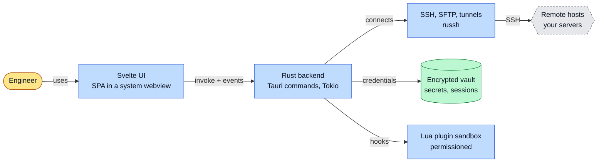
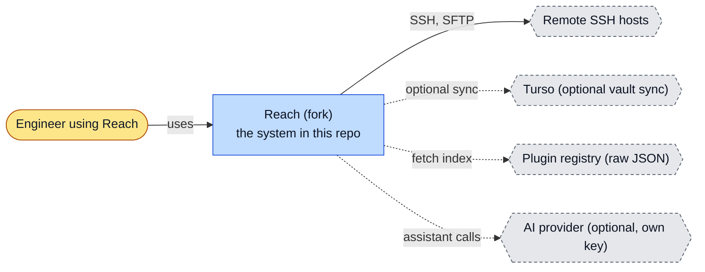
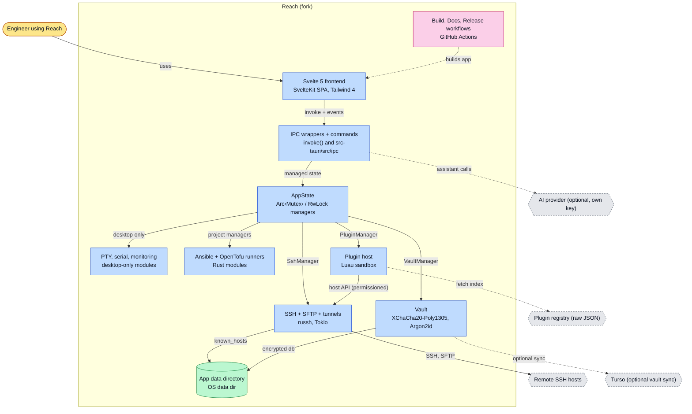
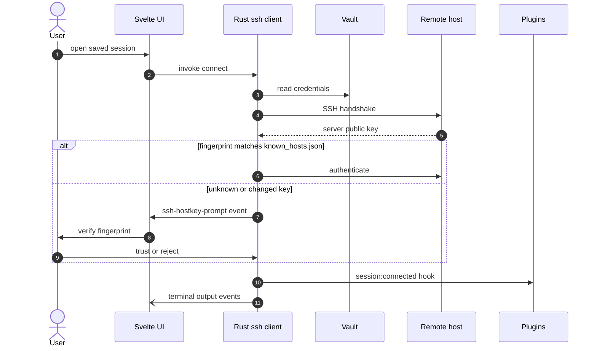
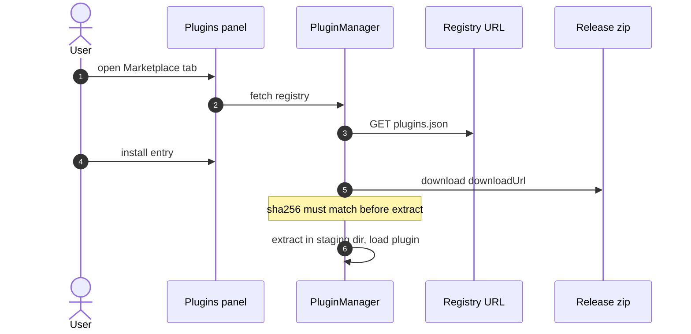
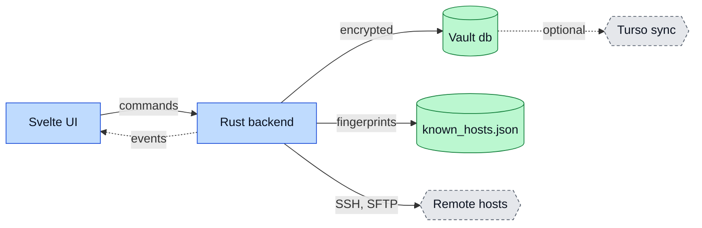
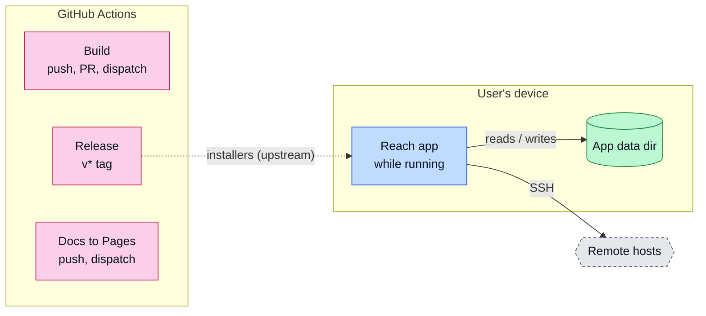

# Reach (fork): architecture

<!-- arch-kit:generated -->

> Whiteboard-level structure: what systems exist, what they talk to, and when they run. Evidence-backed; every box below maps to a path listed in [Evidence](#10-evidence).
> Generated by the ArchDocs kit from repo commit `2fb39e359b`. Diagram sources: [`architecture/*.mmd`](architecture/). Hi-res renders sit next to each source.

## 1. Purpose

Reach is a cross-platform SSH client and remote management tool. This repository is thefiredev-cloud's fork of alexandrosnt/Reach at upstream v0.4.9 with four fixes (macOS copy and paste, vault password change, a saved marketplace registry URL, a support link); upstream is canonical. The app has two halves joined by Tauri v2: a Svelte 5 single-page frontend, and a Rust backend on Tokio. The backend owns SSH (russh), SFTP, tunnels, a PTY, serial ports, monitoring, Ansible and OpenTofu runners, an encrypted vault, and a Luau plugin sandbox. The frontend calls Rust through `invoke` commands and listens to Tauri events for streams.

## 2. Whiteboard view

Seven boxes. The UI never touches a socket or a key: it asks the Rust backend, which owns SSH and the vault.

Hi-res: [SVG](architecture/whiteboard.svg) · [PNG 3x](architecture/whiteboard@3x.png) · [dark SVG](architecture/whiteboard.dark.svg) · [dark PNG 3x](architecture/whiteboard.dark@3x.png)

Explorable version (Archify, standalone HTML, download and open locally): [`architecture/Reach.archify.html`](architecture/Reach.archify.html)

## 3. System context (C4 level 1)

Who and what touches the system from outside.

Hi-res: [SVG](architecture/context.svg) · [PNG 3x](architecture/context@3x.png)

## 4. Containers and components (C4 level 2)

The parts that run or hold data inside the repo's system boundary.

Hi-res: [SVG](architecture/containers.svg) · [PNG 3x](architecture/containers@3x.png)

| Container | Kind | Tech | What it does | Evidence |
|---|---|---|---|---|
| Svelte 5 frontend | app | SvelteKit SPA, Tailwind 4 | Components by feature (terminal, explorer, tunnel, vault, plugins...). State in module-scope runes. | [`src/lib/components/terminal/Terminal.svelte`](../src/lib/components/terminal/Terminal.svelte), [`src/routes/+page.svelte`](../src/routes/+page.svelte), [`docs/src/content/docs/development/architecture.md#L8-L35`](../docs/src/content/docs/development/architecture.md#L8-L35) |
| IPC wrappers + commands | app | invoke() and src-tauri/src/ipc | Frontend wrappers map 1:1 to Rust commands, one file per domain, registered with generate_handler. | [`src/lib/ipc/ssh.ts`](../src/lib/ipc/ssh.ts), [`src-tauri/src/ipc/mod.rs`](../src-tauri/src/ipc/mod.rs), [`src-tauri/src/lib.rs#L138`](../src-tauri/src/lib.rs#L138) |
| AppState | app | Arc<Mutex> / RwLock managers | Central holder for SSH, tunnel, vault, plugin, Ansible and OpenTofu managers. | [`src-tauri/src/state.rs#L9-L20`](../src-tauri/src/state.rs#L9-L20), [`src-tauri/src/lib.rs#L585`](../src-tauri/src/lib.rs#L585) |
| SSH + SFTP + tunnels | app | russh, Tokio | Pure-Rust SSH. Host keys are trusted on first use, and a changed key prompts the user: no silent accept. | [`src-tauri/src/ssh/client.rs#L1187-L1215`](../src-tauri/src/ssh/client.rs#L1187-L1215), [`src-tauri/src/sftp/browser.rs`](../src-tauri/src/sftp/browser.rs), [`src-tauri/src/tunnel/manager.rs`](../src-tauri/src/tunnel/manager.rs) |
| PTY, serial, monitoring | app | desktop-only modules | Local terminal, serial console and agentless host stats. Gated with #[cfg(desktop)]. | [`src-tauri/src/pty/manager.rs`](../src-tauri/src/pty/manager.rs), [`src-tauri/src/serial/port.rs`](../src-tauri/src/serial/port.rs), [`src-tauri/src/monitoring/collector.rs`](../src-tauri/src/monitoring/collector.rs) |
| Ansible + OpenTofu runners | app | Rust modules | Project managers and streaming runners for playbooks and plan/apply. | [`src-tauri/src/ansible/runner.rs`](../src-tauri/src/ansible/runner.rs), [`src-tauri/src/tofu/runner.rs`](../src-tauri/src/tofu/runner.rs) |
| Vault | app | XChaCha20-Poly1305, Argon2id | Encrypted credentials, keys and settings in a libsql database; optional Turso sync; change_password added in this fork. | [`src-tauri/src/vault/crypto.rs`](../src-tauri/src/vault/crypto.rs), [`src-tauri/src/vault/kdf.rs`](../src-tauri/src/vault/kdf.rs), [`src-tauri/src/vault/manager.rs`](../src-tauri/src/vault/manager.rs) |
| Plugin host | app | Luau sandbox | Manifest permissions, hooks, host API, marketplace install with sha256 check. 64 MB VM limit. | [`src-tauri/src/plugin/sandbox.rs`](../src-tauri/src/plugin/sandbox.rs), [`src-tauri/src/plugin/host_api.rs`](../src-tauri/src/plugin/host_api.rs), [`src-tauri/src/plugin/hooks.rs`](../src-tauri/src/plugin/hooks.rs) |
| App data directory | store | OS data dir | known_hosts.json, vault database, plugin folders and settings. | [`src-tauri/src/ssh/client.rs#L1125-L1129`](../src-tauri/src/ssh/client.rs#L1125-L1129), [`docs/src/content/docs/development/architecture.md#L49-L51`](../docs/src/content/docs/development/architecture.md#L49-L51) |
| Build, Docs, Release workflows | job | GitHub Actions | Build on push/PR; Docs to GitHub Pages; Release on v* tags with a desktop matrix and an Android APK. | [`.github/workflows/build.yml`](../.github/workflows/build.yml), [`.github/workflows/docs.yml`](../.github/workflows/docs.yml), [`.github/workflows/release.yml#L3-L6`](../.github/workflows/release.yml#L3-L6) |

## 5. Key runtime sequences

### 5.1 Connect to a host (first time)

Unknown or changed host keys never connect silently.

Hi-res: [SVG](architecture/sequence-1.svg) · [PNG 3x](architecture/sequence-1@3x.png)

### 5.2 Install a plugin from the marketplace

Hi-res: [SVG](architecture/sequence-2.svg) · [PNG 3x](architecture/sequence-2@3x.png)

## 6. Data flow and stores

Secrets stay in the Rust process and the encrypted vault. The frontend receives results and event streams, not keys.

Hi-res: [SVG](architecture/dataflow.svg) · [PNG 3x](architecture/dataflow@3x.png)

| Store | What it holds | Written by | Evidence |
|---|---|---|---|
| Vault database (libsql) | Encrypted credentials, SSH keys, saved settings including the registry URL override. | VaultManager | [`src-tauri/src/vault/manager.rs`](../src-tauri/src/vault/manager.rs), [`src-tauri/src/vault/schema.rs`](../src-tauri/src/vault/schema.rs) |
| ssh/known_hosts.json | Host fingerprints trusted by the user. | SSH client after the user confirms | [`src-tauri/src/ssh/client.rs#L1125-L1129`](../src-tauri/src/ssh/client.rs#L1125-L1129) |
| Plugin directories | plugin.toml and main.lua per plugin, plus storage. | PluginManager, marketplace install | [`src-tauri/src/plugin/manager.rs`](../src-tauri/src/plugin/manager.rs), [`src-tauri/src/plugin/storage.rs`](../src-tauri/src/plugin/storage.rs) |

## 7. Deployment and runtime topology

A desktop (Windows, macOS, Linux) or Android app. No server. CI builds installers and publishes docs.

Hi-res: [SVG](architecture/deployment.svg) · [PNG 3x](architecture/deployment@3x.png)

| What | Where | Runs when | Trigger / port | Evidence |
|---|---|---|---|---|
| Build | GitHub Actions | Every push, PR and manual dispatch | check + desktop jobs | [`.github/workflows/build.yml`](../.github/workflows/build.yml) |
| Release | GitHub Actions | On tags v* | desktop matrix (Windows, macOS x2, Linux) + Android APK | [`.github/workflows/release.yml#L3-L6`](../.github/workflows/release.yml#L3-L6), [`.github/workflows/release.yml#L12-L26`](../.github/workflows/release.yml#L12-L26) |
| Docs deploy | GitHub Pages | Push and manual dispatch | docs.yml | [`.github/workflows/docs.yml`](../.github/workflows/docs.yml) |
| In-app updater | Reach app | Disabled in this fork | plugins.updater.endpoints empty | [`README.md#L31`](../README.md#L31) |

## 8. Failure modes and how to see them

| Failure | What the user sees | How to see it | Evidence |
|---|---|---|---|
| Host key unknown or changed | Connection waits for the user: no silent accept | `ssh-hostkey-prompt` event; known_hosts.json | [`src-tauri/src/ssh/client.rs#L1205-L1215`](../src-tauri/src/ssh/client.rs#L1205-L1215) |
| Vault password never set (upstream snapshot bug) | Set or change password failed; this fork returns a clear error | Error from VaultManager::change_password | [`README.md#L27`](../README.md#L27) |
| Plugin hook errors or times out | Plugin status Error and a toast | Plugins panel | [`src-tauri/src/plugin/hooks.rs`](../src-tauri/src/plugin/hooks.rs) |
| Command fails in Rust | Error string returned to the frontend | All commands return Result<T, String> | [`docs/src/content/docs/development/architecture.md#L59`](../docs/src/content/docs/development/architecture.md#L59) |
| Fork build vs upstream installers | Fork features are absent from upstream installers; fork has a different bundle id | Bundle id com.thefiredev.reach | [`README.md#L31`](../README.md#L31) |

## 9. State machine

No single state machine to draw. SSH connection and plugin status exist in the Rust managers, but their states are not defined as one enum in the files cited here.

## 10. Evidence

Every path below exists at the pinned commit; links are relative to `docs/`.

| Path | Why it matters |
|---|---|
| [`docs/src/content/docs/development/architecture.md`](../docs/src/content/docs/development/architecture.md) | Upstream's own description of the two halves, IPC and data directory. |
| [`src-tauri/src/lib.rs#L91-L138`](../src-tauri/src/lib.rs#L91-L138) | App entry: run(), command handler registration, AppState managed state. |
| [`src-tauri/src/state.rs#L9-L20`](../src-tauri/src/state.rs#L9-L20) | Managers held by AppState. |
| [`src-tauri/src/ssh/client.rs#L1187-L1215`](../src-tauri/src/ssh/client.rs#L1187-L1215) | Host key verification: trust on first use and changed-key prompt. |
| [`src-tauri/src/vault/crypto.rs`](../src-tauri/src/vault/crypto.rs) | Vault encryption. |
| [`src-tauri/src/plugin/sandbox.rs`](../src-tauri/src/plugin/sandbox.rs) | Plugin sandbox. |
| [`.github/workflows/release.yml`](../.github/workflows/release.yml) | Tag-driven desktop and Android release. |
| [`README.md`](../README.md) | What the fork changes against upstream. |

Collected mechanically by the kit ([`architecture/facts.json`](architecture/facts.json), not hand-edited):

- entry points: `start`, `dev`, `build`, `dev`, `build`, `main`
- CI: `.github/workflows/build.yml`, `.github/workflows/docs.yml`, `.github/workflows/release.yml`
- external hosts seen in source: `github.com`, `raw.githubusercontent.com`, `openrouter.ai`, `astro.build`, `alexandrosnt.github.io`, `gitlab.com`

Graphify (local AST, no LLM) read this repo: 4074 nodes, 6339 edges, 254 communities. Most connected: `AppState` (210), `VaultError` (112), `VaultManager` (110), `svelte` (42), `getActiveProject()` (41).

- Report: [`architecture/graphify/GRAPH_REPORT.md`](architecture/graphify/GRAPH_REPORT.md)
